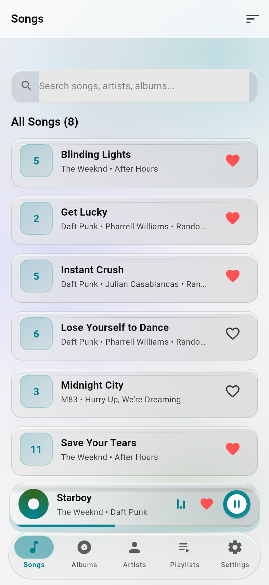
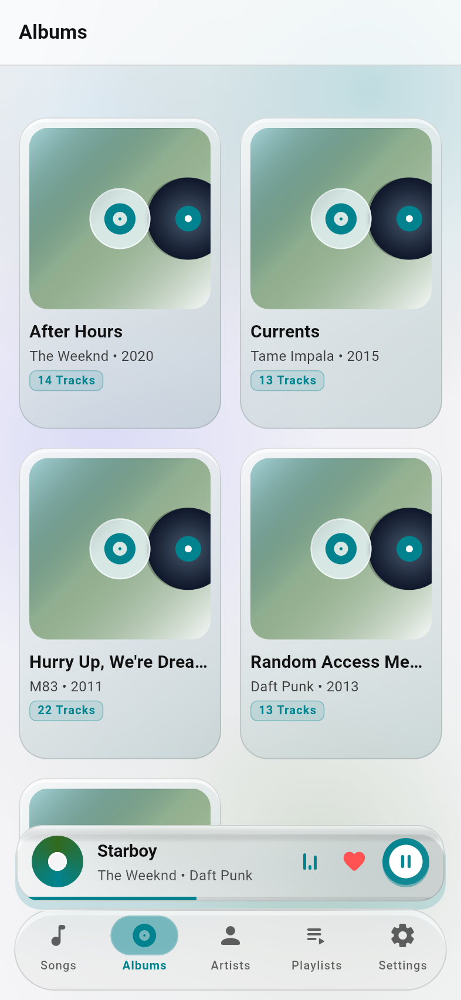
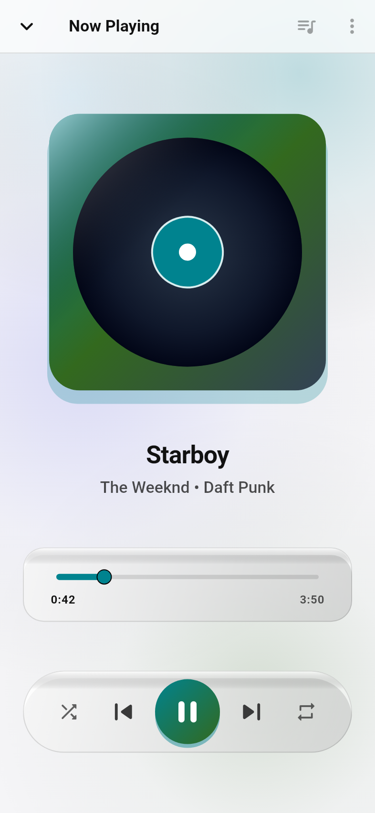
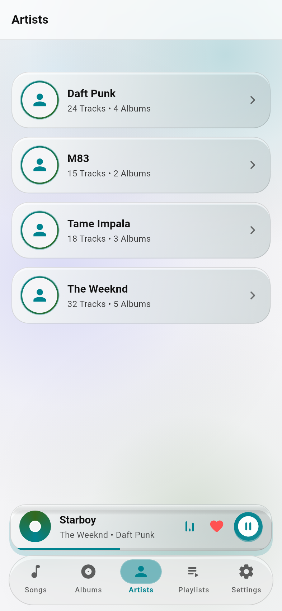
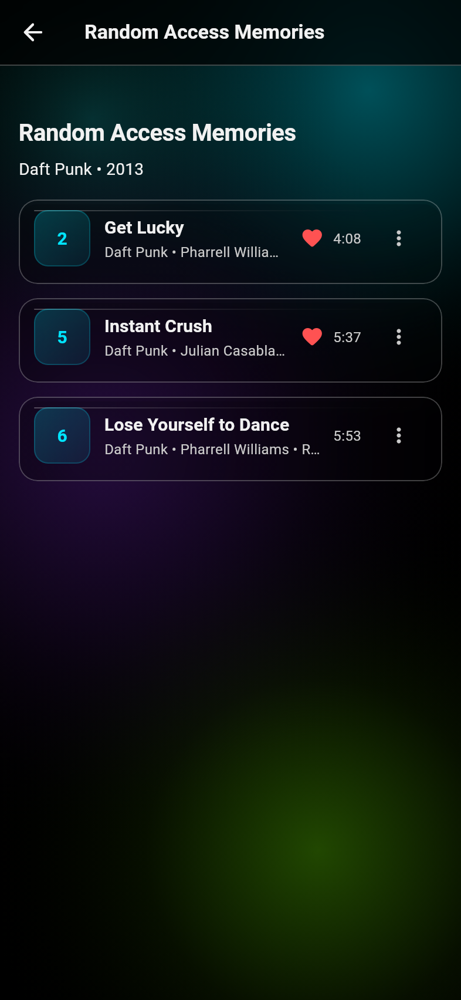
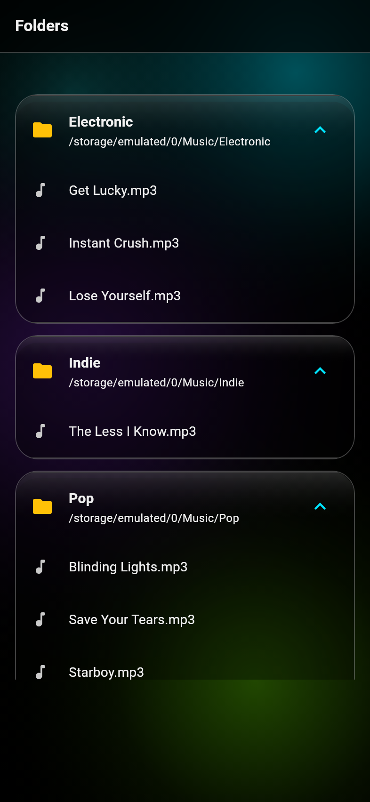
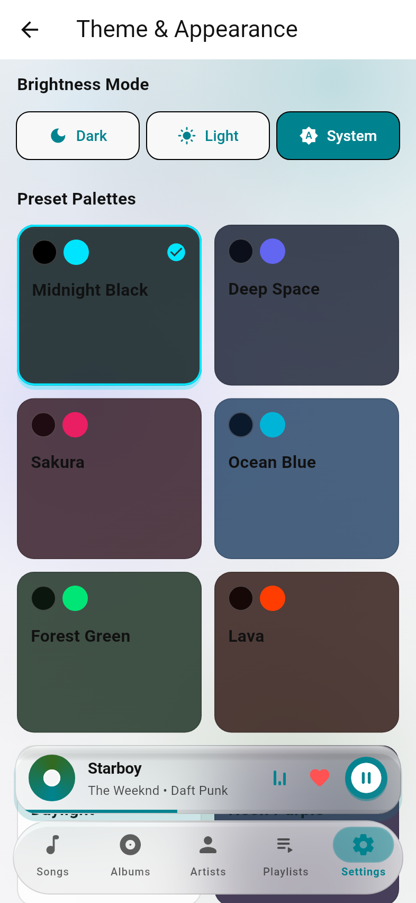
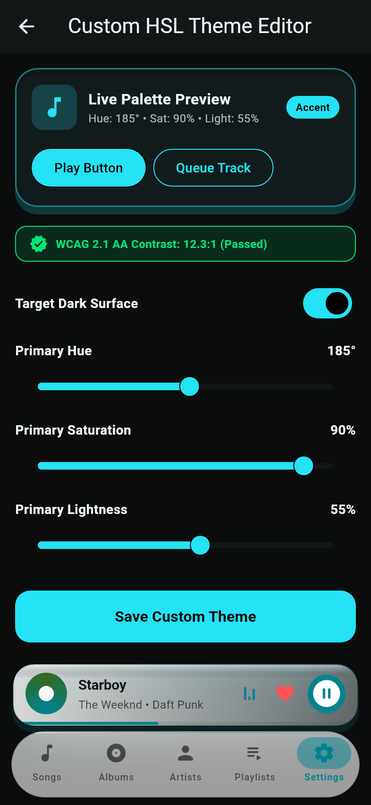
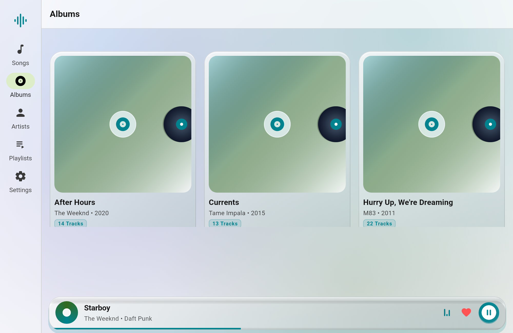

# NEXA Player 🎵

> **Next-Generation Local Music Player for Android, iOS & Desktop**  
> Built with **Flutter**, **SQLite WAL**, and a visionOS-inspired **Bionic Glassmorphism Design System**.

[](#verification--test-suite)
[](#verification--test-suite)
[](#architecture)
[](#next-gen-bionic-glassmorphism)

---

## 📸 Visual Showcase

### Primary Library & Player Experience
| Songs & Frosted Tiles | 3D Vinyl Albums Grid | Now Playing & Rotating Vinyl |
| :---: | :---: | :---: |
|  |  |  |

| Artists & Glowing Rings | Album Detail & Tracklist | Folders Hierarchy |
| :---: | :---: | :---: |
|  |  |  |

### Themes & Adaptive Layout
| Theme Presets & Dark Mode | Custom HSL Editor & WCAG AA | Responsive Desktop / Tablet |
| :---: | :---: | :---: |
|  |  |  |

---

## ✨ Features

### 🎨 Next-Gen Bionic Glassmorphism Design System
* **Optical Aurora Canvas (`AppAmbientBackground`)**: Multi-layered organic aurora mesh canvas with drifting chromatic orbs behind a 20–32dp `BackdropFilter` refraction plane.
* **3D Physical Light Bevels (`GlassTokens`)**: Dual-stop linear surface zenith gradients and 1dp top specular edge reflection lines.
* **3D Vinyl Artwork**: Grooved vinyl discs sliding out of sleeves with center spindle labels and diagonal jewel-case reflections.
* **Floating Capsule Shell**: Floating frosted mini player with spinning vinyl artwork, playback controls, and bottom progress line; floating bottom navigation capsule with glowing active tab pill.
* **Kinetic Spring Physics**: Responsive `AnimatedScale` bounce (0.98 on tap) with `Curves.easeOutCubic`.

### ⚡ Engine & Architecture
* **Pure-Dart Audio Metadata Extractor**: In-process binary tag parser for ID3v2.3/ID3v2.4, RIFF/WAV, and FLAC Vorbis comments with zero platform channel overhead.
* **SQLite Storage Engine**: High-performance SQLite database with `PRAGMA journal_mode = WAL;`, 7 relational tables, 6 query indexes, and cascade deletion rules.
* **Incremental Media Scanner**: Background directory traversal engine with file modification heuristics, duration filtering (e.g. ignoring short voice notes/ringtones), and batch upserts.
* **Theme Customizer**: 8 Material 3 presets (including true AMOLED `#000000`), Dark/Light/System brightness modes, and interactive HSL editor with real-time **WCAG 2.1 AA (4.5:1 / 7:1) contrast clamping**.
* **Adaptive Navigation**: Fluid transition between bottom navigation bar on mobile and persistent `NavigationRail` with multi-column card grids on tablet/desktop viewports ($\ge 800\text{dp}$).

---

## 🏗 Architecture

```mermaid
graph TD
    UI[Flutter UI: Bionic Glassmorphism] --> Aurora[AppAmbientBackground: Chromatic Aurora Mesh]
    UI --> State[State Management: Riverpod 2 Notifiers]
    State --> Repos[Domain Repositories & Services]
    Repos --> DB[(SQLite Database: 7 Tables + WAL Mode)]
    Repos --> Scanner[Pure-Dart Audio Metadata Extractor]
    Scanner --> Storage[Local File Storage & Permissions]
    
    subgraph Core Foundations
        DI[GetIt Service Locator]
        Monad[Result<T, Failure> Functional Monad]
        Log[Talker Structured Logging]
        ThemeEngine[Material 3 + FlexColorScheme 8 + Custom HSL]
    end
    
    State -.-> Core Foundations
```

---

## 🧪 Verification & Test Suite

NEXA Player maintains a **100% green test passing record** with zero skipped tests and zero warnings:

```bash
# Run static analysis (zero issues, zero warnings)
dart analyze --fatal-infos

# Run complete test suite (527 / 527 passing)
flutter test
```

### Test Breakdown
* **Unit Tests**: Domain entities, Result monad folds, duration math, storage services, and scanner heuristics.
* **Stress & Adversarial Tests**: Aspect ratio stress, 10-hour durations, negative timestamps, rapid navigation, and layout overflow boundaries.
* **Widget & Screenshot Tests**: All UI components, screens, theme changes, and responsive layout adapters.

---

## 🚀 Getting Started

### Prerequisites
* Flutter SDK $\ge 3.24.0$
* Dart SDK $\ge 3.5.0$

### Setup
```bash
# Clone the repository
git clone git@github.com:AlirezaAbd-dev/NEXA-Player.git
cd NEXA-Player

# Install dependencies
flutter pub get

# Run on your target platform
flutter run
```

---

## 📄 License & Documentation
* Detailed Roadmap & Architecture: [docs/PLAN.md](docs/PLAN.md)
* Implementation Log & Test Matrix: [TEST_READY.md](TEST_READY.md)
