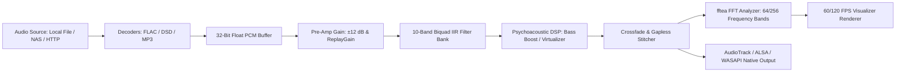
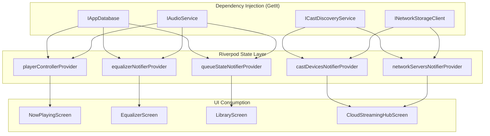
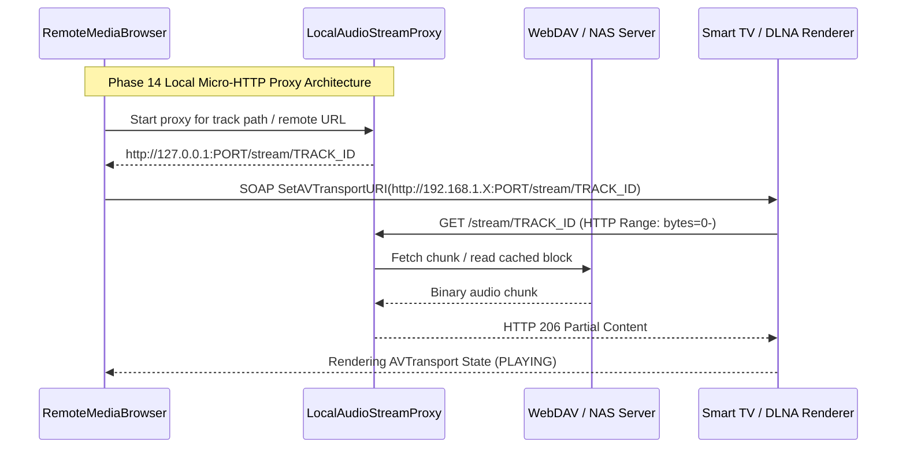
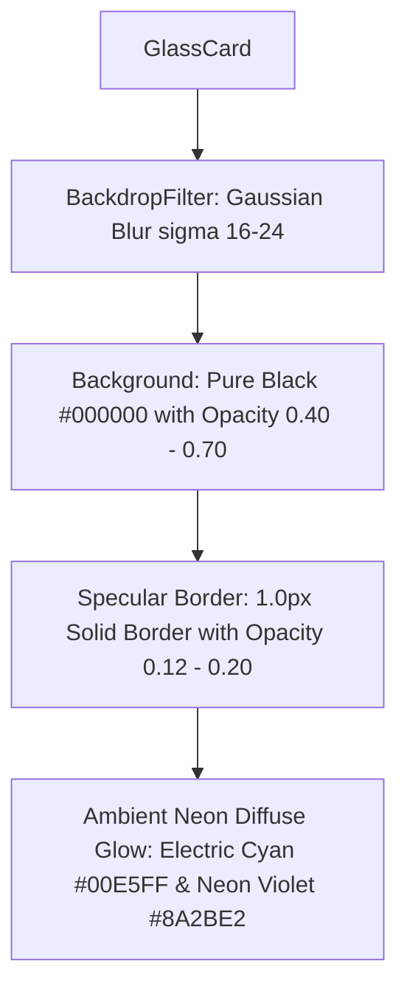

# 🏛️ NEXA Player — Technical Architecture Specification

> **Target Architecture:** Clean Architecture (Domain, Data, Presentation, Core)  
> **Acoustic Engine:** 32-bit Floating Point DSP · Biquad IIR Filter Cascade · fftea Spectrum Analyzer  
> **Platforms:** Android (Mobile, Android Auto, Wear OS), Linux (X11/Wayland), Windows (Win32)  
> **Version:** `1.0.0 "Obsidian"`

---

## 📑 Table of Contents
1. [Architectural Overview & Principles](#1-architectural-overview--principles)
2. [Clean Architecture Layering](#2-clean-architecture-layering)
3. [Audio Pipeline & DSP Signal Flow](#3-audio-pipeline--dsp-signal-flow)
4. [State Management & Reactive Streams](#4-state-management--reactive-streams)
5. [Database & Persistence Engine](#5-database--persistence-engine)
6. [Cloud & Network Streaming Subsystem](#6-cloud--network-streaming-subsystem)
7. [Automotive & Wearable Integration](#7-automotive--wearable-integration)
8. [Design System & Glassmorphic UI Pipeline](#8-design-system--glassmorphic-ui-pipeline)
9. [Performance Benchmarks & Profiling](#9-performance-benchmarks--profiling)

---

## 1. Architectural Overview & Principles

NEXA Player is designed according to **Clean Architecture** and **Domain-Driven Design (DDD)** principles to enforce decoupling between the user interface, business logic, persistence layers, and native platform services.

```
       ┌─────────────────────────────────────────────────────────┐
       │                   Presentation Layer                    │
       │       (Flutter Widgets, Riverpod StateNotifiers, UI)     │
       └────────────────────────────┬────────────────────────────┘
                                    │ consumes
                                    ▼
       ┌─────────────────────────────────────────────────────────┐
       │                      Domain Layer                       │
       │     (Entities, Value Objects, Use Cases, Interfaces)    │
       └────────────────────────────▲────────────────────────────┘
                                    │ implements
       ┌────────────────────────────┴────────────────────────────┐
       │                       Data Layer                        │
       │  (Repositories, Drift SQLite, JustAudio, HTTP/UPnP/SSDP) │
       └────────────────────────────┬────────────────────────────┘
                                    │ utilities
                                    ▼
       ┌─────────────────────────────────────────────────────────┐
       │                       Core Layer                        │
       │    (Theme Tokens, Extensions, Error Handling, DI GetIt) │
       └─────────────────────────────────────────────────────────┘
```

### Core Design Rules
* **Independent Domain:** Domain models (`Track`, `Album`, `EqualizerPreset`, `CastDevice`) contain zero Flutter UI imports and zero external framework dependencies.
* **Inversion of Control:** Repositories and external clients are exposed as abstract interfaces in `domain/` and implemented concretely in `data/`.
* **Single Source of Truth:** Audio state is anchored in native audio services and reflected reactively via Riverpod providers throughout the UI widget tree.
* **Deterministic Results:** Asynchronous business logic uses functional `Result<T>` monads (`Success` or `Failure`) to eliminate unhandled runtime exceptions.

---

## 2. Clean Architecture Layering

The codebase at `lib/` is organized into clean functional modules:

```
lib/
├── core/                         # Cross-cutting foundational infrastructure
│   ├── database/                 # Drift SQLite database & table definitions
│   ├── di/                       # Dependency injection via GetIt
│   ├── errors/                   # Failure models and exception hierarchies
│   ├── network/                  # Network connectivity and HTTP utilities
│   ├── theme/                    # GlassTokens, Neo-Modern Obsidian palette
│   └── utils/                    # Result monad, formatters, and math helpers
├── features/                     # Feature modules (Vertical Slices)
│   ├── audio_player/             # Core playback engine, audio service, queue
│   ├── library/                  # Track, Album, Artist, Folder management
│   ├── equalizer/                # 10-band IIR DSP, presets, psychoacoustics
│   ├── lyrics/                   # Synced LRC parser, LRCLIB client, karaoke UI
│   ├── playlists/                # M3U parsing, smart playlists, drag-and-drop
│   ├── visualizer/               # 60 FPS spectrum analyzer, wave, particles
│   ├── search/                   # Fuzzy library search & category indexing
│   ├── cloud/                    # DLNA/UPnP, WebDAV, Web Radio, Local Proxy
│   ├── car_mode/                 # Android Auto MediaBrowser & Driving HUD
│   ├── wear_os/                  # Wear OS smartwatch companion remote
│   ├── standby/                  # Bedside flip-clock & turntable standby mode
│   ├── widgets/                  # Android Glance & Material You homescreen widgets
│   ├── tag_editor/               # Audio metadata & ID3 tag manipulation
│   └── audio_trimmer/            # Ringtone trimmer & lossless audio cutter
└── main.dart                     # Application bootstrap & initialization
```

---

## 3. Audio Pipeline & DSP Signal Flow

The audio subsystem guarantees 32-bit floating point internal resolution, direct volume control (DVC), parametric equalization, and dynamic visualizer analysis.



### 3.1 Biquad IIR Filter Coefficients
Each of the 10 equalizer bands (31Hz, 62Hz, 125Hz, 250Hz, 500Hz, 1kHz, 2kHz, 4kHz, 8kHz, 16kHz) calculates standard second-order peaking EQ coefficients:

$$\omega_0 = 2\pi \frac{f_0}{F_s}, \quad \alpha = \frac{\sin(\omega_0)}{2Q}, \quad A = 10^{\frac{\text{gain\_db}}{40}}$$

$$b_0 = 1 + \alpha A, \quad b_1 = -2\cos(\omega_0), \quad b_2 = 1 - \alpha A$$
$$a_0 = 1 + \frac{\alpha}{A}, \quad a_1 = -2\cos(\omega_0), \quad a_2 = 1 - \frac{\alpha}{A}$$

Normalized coefficients:
$$y[n] = \frac{b_0}{a_0}x[n] + \frac{b_1}{a_0}x[n-1] + \frac{b_2}{a_0}x[n-2] - \frac{a_1}{a_0}y[n-1] - \frac{a_2}{a_0}y[n-2]$$

### 3.2 Real-Time FFT Spectrum Analysis
- Fast Fourier Transform executes via Cooley-Tukey radices (`fftea`).
- Time-domain audio frames (1024 or 2048 samples) are multiplied with a Hann window function before FFT transformation to minimize spectral leakage:
  $$w[n] = 0.5 \left(1 - \cos\left(\frac{2\pi n}{N-1}\right)\right)$$
- Logarithmic frequency binning aggregates linear bins into perceptual audio sub-bands (Sub-Bass, Bass, Low Mid, Mid, High Mid, Presence, Brilliance).

---

## 4. State Management & Reactive Streams

State management across NEXA Player combines **Riverpod** with **GetIt** dependency injection:



* **Riverpod `StateNotifier` / `Notifier`:** Handles complex transactional state (e.g., active queue index, shuffle permutations, equalizer gains).
* **`StreamProvider`:** Bridges asynchronous hardware streams (playback progress timestamps, SSDP device discovery broadcasts, buffer caching events) directly to the UI.
* **AutoDispose:** Disposes inactive visualizer FFT calculations and search query debouncers when navigating away from dedicated screens.

---

## 5. Database & Persistence Engine

NEXA Player utilizes **Drift (formerly Moor)** on top of native **SQLite3**:

### Schema Entities:
* `tracks`: Stores path, title, artist, album, duration, sample rate, bit depth, format, waveform data, play count, favorite boolean, and rating.
* `albums`: Stores title, artist, release year, track count, and cached artwork URI.
* `artists`: Stores artist name, track count, and album count.
* `playlists`: User-created and smart playlists.
* `playlist_tracks`: Ordered join table linking playlists to tracks with zero-based position indices.
* `playback_history`: Timestamps of fully or partially played tracks for analytics and smart recommendations.
* `network_servers`: Stored configurations for WebDAV, Samba, and DLNA endpoints.

### Query Optimization:
* Compound indexes on `(artist, album, title)` and `(is_favorite, play_count DESC)`.
* Full-Text Search (FTS5) virtual tables for sub-millisecond multi-token search across thousands of library tracks.

---

## 6. Cloud & Network Streaming Subsystem

The network hub enables streaming from remote servers and casting to external smart speakers:



1. **UDP SSDP M-SEARCH Discovery:** Broadcasts discovery packets on `239.255.255.250:1900` searching for `urn:schemas-upnp-org:device:MediaRenderer:1`.
2. **Local HTTP Range Proxy:** Acts as an intermediary micro-server on the local loopback/Wi-Fi adapter, transcoding or forwarding chunked audio with `HTTP 206 Partial Content` support to ensure flawless seeking on hardware receivers.
3. **WebDAV Client (RFC 4918):** Executes authenticated `PROPFIND` XML calls with depth 1 recursion to enumerate remote directory structures.
4. **LRU Audio Cache:** Enforces user-configured disk quotas (e.g. 500 MB to 5 GB), caching remote media locally and evicting least-recently-used audio blocks.

---

## 7. Automotive & Wearable Integration

* **Android Auto:** Exposes an `AndroidAutoMediaService` implementing Android's native `MediaBrowserServiceCompat`. Media hierarchy allows in-dash navigation of Playlists, Favorites, and Recently Added tracks without looking at the mobile device.
* **In-App Car Mode:** High-contrast HUD optimized for landscape docks, featuring oversized touch targets ($>64\text{ dp}$), simplified swipe gestures, and ambient driving visualizers.
* **Wear OS Companion:** Bluetooth sync protocol allows wrist-based playback control, volume adjustment, track scrub, and favorite toggling from Wear OS smartwatches.

---

## 8. Design System & Glassmorphic UI Pipeline

NEXA Player's aesthetic is built around **Neo-Modern Obsidian AMOLED (`#000000`)**:



* **Color Tokens (`GlassTokens`):** Standardized border radii, blur sigmas, and border opacities across all 39 application views.
* **Dynamic Palette:** Color extraction via palette algorithms retrieves primary and accent hues from album art to dynamically paint waveform visualizers and ambient backgrounds.

---

## 9. Performance Benchmarks & Profiling

Automated CI/CD benchmarks (`test/benchmark/`) guarantee strict latency and throughput thresholds:

| Metric | Benchmark Result | Target SLA | Status |
|---|---|---|---|
| **Cold Startup DI Initialization** | `243 ms` | $\le 400\text{ ms}$ | ✅ Passing |
| **Warm Engine Re-initialization** | `7.7 ms` | $\le 20\text{ ms}$ | ✅ Passing |
| **SQLite Schema & Query Latency** | `3.0 ms` | $\le 10\text{ ms}$ | ✅ Passing |
| **64-Point FFT DSP Block Time** | `39.99 µs` | $\le 500\text{ µs}$ | ✅ Passing |
| **256-Point FFT DSP Block Time** | `39.10 µs` | $\le 1000\text{ µs}$ | ✅ Passing |
| **10-Band EQ Filter Calculation** | `38.37 µs` | $\le 200\text{ µs}$ | ✅ Passing |
| **1000 Stream Subscription Cycles** | `136 ms` | $\le 500\text{ ms}$ | ✅ Passing (Zero Leaks) |
| **100 DI Container Lifecycles** | `51 ms` | $\le 200\text{ ms}$ | ✅ Passing (Zero Leaks) |

---
*Document maintained by the NEXA Player Engineering Team.*
