# NEXA Player — Hardware Testing & Systemic Audit Report
**Document ID**: `AUDIT-2026-HW01`  
**Target Reviewer**: Argon (Lead Architect / Systems Advisor) & Core Engineering Team  
**Evaluation Target**: NEXA Player v1.1.0 Production Release (`nexa-player-v1.1.0.apk`)  
**Physical Test Device**: Huawei Y9s (`STK-L21`)  
- **SoC**: HiSilicon Kirin 710F (4x Cortex-A73 @ 2.2GHz + 4x Cortex-A53 @ 1.7GHz)  
- **OS / Software**: Android 10 (API level 29) running EMUI 10.0.0  
- **Memory & Storage**: 6 GB RAM, 128 GB UFS 2.1 Internal Storage + MicroSD  
- **Display**: 6.59" Ultra FullView IPS LCD (2340 x 1080 @ 391 ppi)  
**Date**: November 23, 2026  

---

## 1. Executive Summary

Following the successful resolution of the EMUI sideload installation gate (v1/v2 release signing and `extractNativeLibs="true"`), NEXA Player v1.1.0 was installed and dogfooded on real physical hardware (Huawei Y9s).

While the application boots smoothly with high visual fidelity, **six critical defects** in data hydration, device storage access, gesture physics, UI container geometry, and library architecture were identified:

1. **Production Mock Data Contamination**: The SQLite database unconditionally seeds unplayable dummy tracks on fresh install, leading to playback failures.
2. **Missing Runtime Permission & Scanner Failure**: The media scanner never requests Android storage permissions, causing silent failures on real storage directories.
3. **Absence of Now Playing Dismiss Gesture**: The full-screen Now Playing interface lacks an interactive drag-down dismiss gesture to return to the mini-player.
4. **Abrupt Track Switching (Missing Stellio-Style Cover Transition)**: Swiping horizontally between tracks snaps abruptly without continuous physics, inertia, or coverflow animation.
5. **Settings Container Padding & Border Radius Clipping**: Setting cards lack internal padding, causing text to clip against anti-aliased rounded corners.
6. **Orphaned Folder Directory Navigation**: While folder indexing logic and a folder screen exist in the codebase, they are completely excluded from the navigation router and library UI.

This audit provides detailed root-cause analyses, codebase references, and architectural recommendations for each issue for Argon's review and strategic guidance.

---

## 2. Defect Matrix

| ID | Issue Description | Component / Subsystem | Severity | Impact |
|:---|:---|:---|:---:|:---|
| **DEF-01** | Unplayable demo songs seeded in production | `lib/core/di/injection.dart` | **High** | Corrupts first-run UX; broken playback |
| **DEF-02** | Zero runtime storage permissions & scanner failure | `lib/features/scanner/` & AndroidManifest | **Critical** | Scanner finds 0 tracks; storage inaccessible |
| **DEF-03** | Lack of drag-down interactive dismiss gesture | `lib/features/player/presentation/screens/now_playing_screen.dart` | **Medium** | Violates mobile music player UX conventions |
| **DEF-04** | Abrupt horizontal track skip without Stellio animation | `lib/features/player/presentation/widgets/hero_artwork_card.dart` | **Medium** | Jarring visual transition between songs |
| **DEF-05** | Text clipping under rounded card corners in Settings | `lib/features/settings/` & `GlassCard` | **Medium** | Degraded aesthetic quality and readability |
| **DEF-06** | Folder hierarchy view completely missing from UI | `lib/features/library/` & Router Shell | **High** | Users cannot browse tracks by storage folder |

---

## 3. Deep-Dive Defect Analysis

### Defect 1: Hardcoded Demo Seed Injected in Production Environments
- **Observed Behavior**: Upon first opening the freshly installed app, the library displays tracks such as *"Starboy"*, *"Get Lucky"*, and *"Midnight City"*. Tapping any track results in playback errors or immediate silence.
- **Expected Behavior**: A production install should initialize with an empty library state prompting the user to scan their local storage. Demo/mock data should only ever appear in automated tests or when an explicit demo mode flag is active.
- **Codebase Root Cause**:
  In [injection.dart](file:///home/alirezaabd/Main/Projects/NEXA-player/lib/core/di/injection.dart#L85-L365):
  ```dart
  Future<void> configureDependencies({
    ...
    bool seedDemoData = true, // Defaulted to true!
  }) async {
    ...
    if (seedDemoData && !db.isClosed) {
      _seedDemoData(db); // Inserts mock tracks with fictitious paths
    }
  }
  ```
  In [main.dart](file:///home/alirezaabd/Main/Projects/NEXA-player/lib/main.dart#L10), `configureDependencies()` is called without arguments, passing `seedDemoData: true` on production release builds. The seeded paths (`/storage/emulated/0/Music/Pop/Starboy.mp3`) do not exist on the user's device, causing `JustAudioEngine` to fail when attempting to load the non-existent file. Furthermore, because `_seedDemoData` checks `if (albumCount > 0) return;`, having seeded fake tracks blocks legitimate empty-state onboarding.
- **Technical Remedy**:
  1. Default `seedDemoData` to `false` in production or guard with `kDebugMode && !kReleaseMode`.
  2. Implement an automated database migration/cleanup script that deletes seeded mock tracks (`WHERE id LIKE 'trk-%' AND file_path LIKE '/storage/emulated/0/Music/Pop/%'`) on startup.

---

### Defect 2: Storage Permission Flow & File Scanner Failure on Device
- **Observed Behavior**: In Settings > Media Scanner, pressing "Scan Now" immediately completes with 0 tracks found. Android never prompts the user for storage permission.
- **Expected Behavior**: Tapping "Scan Now" (or on initial library setup) should check storage permissions, request `Permission.storage` (or `Permission.audio` on Android 13+), display an educational rationale dialog if denied, and then recursively index the filesystem.
- **Codebase Root Causes**:
  1. **No Runtime Permission Invocation**:
     Although `permission_handler: ^12.0.3` is declared in `pubspec.yaml`, neither `Permission.storage.request()` nor `Permission.audio.request()` is ever called before triggering `_startRescan()` in [scanner_settings_screen.dart](file:///home/alirezaabd/Main/Projects/NEXA-player/lib/features/settings/presentation/screens/scanner_settings_screen.dart#L117-L130).
  2. **Android 10 Scoped Storage Block**:
     The Huawei Y9s runs Android 10 (API 29). In [AndroidManifest.xml](file:///home/alirezaabd/Main/Projects/NEXA-player/android/app/src/main/AndroidManifest.xml#L18-L23), `<application>` is missing `android:requestLegacyExternalStorage="true"`. On Android 10, raw POSIX file traversal (`Directory.listSync()`) fails without legacy external storage mode enabled.
  3. **Silent Exception Swallowing**:
     In [media_scanner_service_impl.dart](file:///home/alirezaabd/Main/Projects/NEXA-player/lib/features/scanner/data/media_scanner_service_impl.dart#L290-L293):
     ```dart
     try {
       final entities = dir.listSync(followLinks: false);
     } catch (_) {
       // Silently swallowed! No error logged, no state emitted.
     }
     ```
     When `listSync` throws `FileSystemException: Permission denied (errno = 13)`, it is swallowed without notifying the UI.
  4. **Hardcoded Directory Seeds**:
     The database seeds scan paths (`/storage/emulated/0/Music`, `/storage/emulated/0/Download`) which may not exist or may have different casing on user devices. There is no folder-picker dialog integration (`file_picker`) to allow users to select custom folders.
- **Technical Remedy**:
  1. Create a `StoragePermissionService` utilizing `permission_handler` to orchestrate runtime requests for `Permission.audio` (API 33+) and `Permission.storage` (API < 33).
  2. Add `android:requestLegacyExternalStorage="true"` to `<application>` in `AndroidManifest.xml`.
  3. Update `MediaScannerServiceImpl` to emit clear error states (`ScannerStatus.error`) when permission is denied or access is restricted.
  4. Provide dynamic standard path discovery (`/storage/emulated/0/Music`, `/storage/emulated/0/Download`, SD card roots via `path_provider`).

---

### Defect 3: Absence of Now Playing Dismiss Gesture (Drag-Down to Animate Closed)
- **Observed Behavior**: When viewing the full-screen Now Playing screen, swiping or dragging down does nothing. The user must reach for the system back button or top-left back icon.
- **Expected Behavior**: Modern music players (Spotify, Apple Music, Samsung Music) allow users to drag down on the Now Playing screen (or from a top grabber handle) to interactively slide the screen down and morph back into the persistent mini-player.
- **Codebase Root Cause**:
  In [router.dart](file:///home/alirezaabd/Main/Projects/NEXA-player/lib/app/router.dart#L164-L168), the player is registered as an ordinary `GoRoute`:
  ```dart
  GoRoute(
    parentNavigatorKey: _rootNavigatorKey,
    path: AppRoutes.player,
    builder: (context, state) => const NowPlayingScreen(),
  )
  ```
  In [now_playing_screen.dart](file:///home/alirezaabd/Main/Projects/NEXA-player/lib/features/player/presentation/screens/now_playing_screen.dart#L194-L213), vertical gestures are only captured by two 32dp edge zones designated for Speed and Volume. There is no top drag handle, no `Dismissible`, and no gesture controller bound to the page route transition.
- **Technical Remedy**:
  1. Wrap `NowPlayingScreen` in an interactive dismissal coordinator (e.g. `GestureDetector` tracking vertical delta with velocity thresholds, or a specialized sheet controller).
  2. Animate page translation (`Transform.translate(offset: Offset(0, dragY))`) and opacity in real-time, completing the pop transition if dragged past 150dp or with downward velocity $> 800\text{ dp/s}$.

---

### Defect 4: Abrupt Track Skipping (Missing Stellio-Style Fluid Transition)
- **Observed Behavior**: In Now Playing, dragging horizontally across the artwork abruptly snaps to the next track. The artwork jumps instantly with zero physical transition, depth, or visual continuity.
- **Expected Behavior (Stellio / Apple Music benchmark)**:
  - Swiping horizontally should physically drag the current artwork out while smoothly pulling the next/previous track's artwork in from the side.
  - The transition should include 3D perspective rotation, scale parallax, and synchronized crossfading of the background ambient palette.
- **Codebase Root Cause**:
  In [hero_artwork_card.dart](file:///home/alirezaabd/Main/Projects/NEXA-player/lib/features/player/presentation/widgets/hero_artwork_card.dart#L111-L130):
  ```dart
  void _handleHorizontalDragUpdate(DragUpdateDetails details) {
    setState(() {
      _swipeDragDelta += details.primaryDelta ?? 0.0;
    });
  }

  void _handleHorizontalDragEnd(DragEndDetails details) {
    if (_swipeDragDelta < -60.0) widget.onSwipeLeft?.call();
    else if (_swipeDragDelta > 60.0) widget.onSwipeRight?.call();
    setState(() { _swipeDragDelta = 0.0; }); // Snaps abruptly to zero!
  }
  ```
  The drag simply offsets the single active card by `_swipeDragDelta * 0.4`. On release, `_swipeDragDelta` is abruptly reset to `0.0`, and the parent triggers `skipNext()`. Because there is no dual-buffer or `PageView`, the next track's artwork is not preloaded or animated into view.
- **Technical Remedy**:
  1. Replace the single-card horizontal drag with an infinite or queue-bound `PageView.builder` or a dual-card interactive Cover Flow controller.
  2. Implement a 3D transform applying:
     $$\text{Angle} = \text{dragProgress} \times \frac{\pi}{6}, \quad \text{Scale} = 1.0 - |\text{dragProgress}| \times 0.15$$
  3. Pre-fetch adjacent track metadata and artwork from `IPlaybackQueue` so the incoming card is fully rendered during the gesture.

---

### Defect 5: Settings Container Padding & Border Radius Clipping
- **Observed Behavior**: In multiple Settings screens (such as Media Scanner and About), text, buttons, and progress indicators sit right against the edge of the card. Due to the 16-20dp rounded corners and anti-aliased clipping, characters at the corners are partially cut off.
- **Expected Behavior**: Content inside elevated cards must respect adequate inner padding (minimum 16dp horizontal and vertical) so that text never touches or clips against the curved boundaries.
- **Codebase Root Causes**:
  1. In [glass_card.dart](file:///home/alirezaabd/Main/Projects/NEXA-player/lib/shared/widgets/glass/glass_card.dart#L27-L37):
     ```dart
     this.padding, // Null by default!
     this.clipBehavior = Clip.antiAlias,
     ```
     If `padding` is not explicitly passed, it defaults to `null`, meaning child content starts at coordinate `(0, 0)` inside the container.
  2. In [scanner_settings_screen.dart](file:///home/alirezaabd/Main/Projects/NEXA-player/lib/features/settings/presentation/screens/scanner_settings_screen.dart#L158-L235), `GlassCard` is instantiated directly without specifying `padding`:
     ```dart
     GlassCard(
       child: Column(
         crossAxisAlignment: CrossAxisAlignment.start,
         children: [
           Text('Scanner Status', ...), // Starts at (0, 0) right against the rounded corner!
     ```
  3. In [settings_tiles.dart](file:///home/alirezaabd/Main/Projects/NEXA-player/lib/features/settings/presentation/widgets/settings_tiles.dart#L13-L16), `SettingsGroupCard` specifies:
     ```dart
     this.padding = const EdgeInsets.symmetric(
       horizontal: AppSpacing.md, // 16.0
       vertical: AppSpacing.sm,   // 8.0 - Too tight for 20dp border radius!
     );
     ```
- **Technical Remedy**:
  1. Update `GlassCard` to enforce a standard default padding: `EdgeInsets.all(AppSpacing.md)` (16dp).
  2. Update `SettingsGroupCard` to use `EdgeInsets.symmetric(horizontal: AppSpacing.md, vertical: AppSpacing.md)`.
  3. Audit and apply explicit padding to all raw `GlassCard` usages across settings screens.

---

### Defect 6: Missing Folder Hierarchy / Directory Navigation in Library
- **Observed Behavior**: Users have no tab, screen, or menu item to browse audio files categorized by their filesystem folders (e.g. `Music/Rock`, `Download/Albums`).
- **Expected Behavior**: The library should provide a dedicated "Folders" browser allowing hierarchical navigation through scanned directories and viewing tracks grouped by directory.
- **Codebase Root Causes**:
  1. A complete folder screen already exists in [folders_tab_screen.dart](file:///home/alirezaabd/Main/Projects/NEXA-player/lib/features/library/presentation/screens/folders_tab_screen.dart), and [sqlite_folders_repository.dart](file:///home/alirezaabd/Main/Projects/NEXA-player/lib/features/library/data/repositories/sqlite_folders_repository.dart) successfully groups tracks by `p.dirname(filePath)`.
  2. However, the screen is **completely orphaned**:
     - Not registered in [routes.dart](file:///home/alirezaabd/Main/Projects/NEXA-player/lib/app/routes.dart).
     - Not registered in [router.dart](file:///home/alirezaabd/Main/Projects/NEXA-player/lib/app/router.dart).
     - Not included in [scaffold_with_nav_bar.dart](file:///home/alirezaabd/Main/Projects/NEXA-player/lib/app/shell/scaffold_with_nav_bar.dart) (which only lists Songs, Albums, Artists, Playlists, Settings).
     - No navigation link exists in the Library header or Songs tab.
- **Technical Remedy**:
  1. Register `AppRoutes.folders` in `router.dart`.
  2. Expose Folders either as a secondary navigation tab in the Library header (e.g. a segmented control in Songs / Library: `Songs | Albums | Artists | Folders | Playlists`) or as a navigable section in the main shell.

---

## 4. Architectural Blueprints & Proposed Solutions

```mermaid
flowchart TD
    subgraph Data Layer & Permission Flow
        A["App Boot (main.dart)"] --> B{"kReleaseMode?"}
        B -->|Yes| C["Skip Demo Seeding\nPurge Any Mock Tracks"]
        B -->|No| D["Allow Test Seeding if Configured"]
        C --> E["Check Storage / Audio Permission"]
        E -->|Not Granted| F["Display Permission Rationale Dialog"]
        F --> G["Request Permission (permission_handler)"]
        G -->|Granted| H["MediaScannerService.scanDirectories()"]
        G -->|Denied| I["Show Fallback Empty State + Open App Settings Button"]
        H --> J["Auto-Discover Device Audio Folders\n(/storage/emulated/0/Music, Download)"]
        J --> K["Batch Upsert to SQLite Tracks Table"]
    end

    subgraph Presentation & Gesture Architecture
        L["NowPlayingScreen"] --> M["InteractivePullDownDismissController"]
        M -->|Drag Down > 150dp or Velocity > 800| N["Slide & Fade Dismiss to MiniPlayer"]
        
        L --> O["HeroArtworkCoverFlow (PageView.builder)"]
        O -->|Horizontal Drag| P["3D Perspective Rotate + Scale + Ambient Blend"]
        P -->|Page Settled| Q["Trigger Queue Skip (skipNext / skipPrevious)"]

        R["Library Navigation Shell"] --> S["Integrated FoldersTabScreen"]
        S --> T["SqliteFoldersRepository (Group by dirPath)"]
        
        U["GlassCard & SettingsGroupCard"] --> V["Enforce Minimum 16dp Inner Padding Contract"]
    end
```



### 4.1. Proposed Storage Permission Orchestrator

```dart
class StoragePermissionOrchestrator {
  static Future<bool> ensureStoragePermission(BuildContext context) async {
    final status = await _checkStatus();
    if (status.isGranted) return true;

    if (status.isPermanentlyDenied) {
      _showSettingsDialog(context);
      return false;
    }

    final requested = await _requestPermission();
    return requested.isGranted;
  }

  static Future<PermissionStatus> _checkStatus() async {
    if (Platform.isAndroid) {
      final sdkInt = await _getAndroidSdkInt();
      if (sdkInt >= 33) return Permission.audio.status;
      return Permission.storage.status;
    }
    return PermissionStatus.granted;
  }

  static Future<PermissionStatus> _requestPermission() async {
    if (Platform.isAndroid) {
      final sdkInt = await _getAndroidSdkInt();
      if (sdkInt >= 33) return Permission.audio.request();
      return Permission.storage.request();
    }
    return PermissionStatus.granted;
  }
}
```

### 4.2. Proposed Stellio-Style 3D Coverflow Carousel

```dart
PageView.builder(
  controller: _pageController,
  itemCount: queue.tracks.length,
  onPageChanged: (index) => ref.read(playerNotifierProvider.notifier).skipToIndex(index),
  itemBuilder: (context, index) {
    return AnimatedBuilder(
      animation: _pageController,
      builder: (context, child) {
        double value = 0.0;
        if (_pageController.position.haveDimensions) {
          value = (_pageController.page ?? _pageController.initialPage.toDouble()) - index;
        }
        
        // 3D Matrix Transform with depth and rotation
        final matrix = Matrix4.identity()
          ..setEntry(3, 2, 0.0015)
          ..rotateY(value * (math.pi / 5))
          ..scale(1.0 - (value.abs() * 0.18).clamp(0.0, 0.5));

        return Transform(
          transform: matrix,
          alignment: value > 0 ? Alignment.centerRight : Alignment.centerLeft,
          child: child,
        );
      },
      child: TrackArtworkCard(track: queue.tracks[index]),
    );
  },
)
```

---

## 5. Action Items & Decisions for Argon

1. **Permission & Onboarding Strategy**:
   - Approve adding the `android:requestLegacyExternalStorage="true"` flag in `AndroidManifest.xml` for Android 10 backward compatibility.
   - Confirm whether first-run setup should trigger an initial auto-scan or prompt via an onboarding bottom sheet.
2. **Library Navigation Architecture**:
   - Decision on Folders placement: Should Folders be added as an independent top-level tab in `GlassBottomNav` (expanding to 6 tabs), or should the Library be structured with an internal sub-tab bar (`Songs | Albums | Artists | Folders | Playlists`)?
3. **Now Playing Interactive Physics**:
   - Review the proposed `PageView.builder` 3D Cover Flow approach versus a dual-card PanGesture transition.
   - Confirm target velocity threshold ($800\text{ dp/s}$) and displacement ($150\text{ dp}$) for the drag-down dismiss gesture.
4. **Data Hygiene**:
   - Approve deprecation of unconditional `_seedDemoData` and authorize an automatic startup cleanup for existing mock records in the local SQLite database.

---
*Report compiled and verified against physical test results on Huawei Y9s (EMUI 10 / Kirin 710F).*
